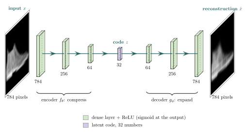
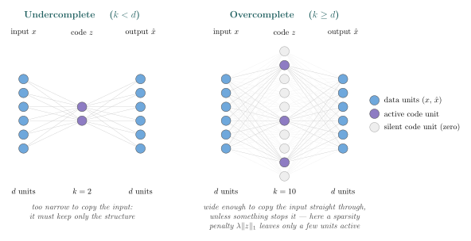

## Learning Objectives

By the end of this lesson you will be able to:

- **Define** an autoencoder formally -- an encoder $f_\theta$, a latent code $z$, a decoder $g_\phi$, and
  a reconstruction objective -- and **explain** why training it needs no labels. *(Understand)*
- **Explain** what stops an autoencoder from simply copying its input: an **undercomplete** bottleneck,
  or a constraint (sparsity, denoising, a contractive penalty) when the code is **overcomplete**.
  *(Understand)*
- **Explain** how the **loss function** decides what an autoencoder learns: why pixel losses blur,
  and how the VAE's loss makes its latent space smooth enough to sample from. *(Understand / Analyze)*
- **Build and train** MLP, convolutional, denoising and variational autoencoders in PyTorch, and
  **read** their reconstructions and latent spaces. *(Apply -- in the lab)*
- **Use** autoencoders for real tasks -- a representation for classification, anomaly detection by
  reconstruction error, editing an image by moving its code -- including a **pretrained** autoencoder
  loaded from a model hub. *(Apply / Analyze -- in the lab)*

> **Where this sits:** after `L19 — CNN Architectures & Transfer Learning`, which reused features learned
> from *labels*. This is Unit V's first **unsupervised** network: it learns useful features from the
> data alone. · next: `L21 — Attention Mechanisms`, which lets a model choose what to focus on.
>
> **Hands-on:** [Lab — Autoencoders, from Scratch to Stable Diffusion](l20_lab_autoencoders.md) ·
> [](https://colab.research.google.com/github///blob//u05_deep_learning/l20_lab_autoencoders.ipynb)

## Why This Matters

Every network so far learned from **labels** -- L19 even reused the features that ImageNet's labels paid
for. But labels are expensive and most data has none. An **autoencoder** needs no labels at all: it
learns by trying to **reconstruct its own input**, supervising itself.

The trick is a deliberate handicap. Funnel each image through a layer far too narrow to carry all its
pixels -- a **bottleneck** -- and the network cannot simply copy the input across. To rebuild the image
from those few numbers, it has to discover the structure that lets a short code stand in for the whole
picture. The analogy: a sketch artist who has drawn thousands of faces can capture a new one in a few
strokes, because experience taught them which features matter. An autoencoder is forced to invent those
strokes, and the short code it learns turns out to be a genuinely useful **representation** of the data.

This is not a museum piece. When Stable Diffusion draws a picture, it does not work on pixels: it works
in the **latent space of an autoencoder**, and an autoencoder's decoder turns the result into the image
you see. In the lab you will load that very autoencoder and run a photo through it.

## The Formal Definition

An autoencoder is two functions trained together. The **encoder** $f_\theta$ maps an input
$x \in \mathbb{R}^d$ to a **latent code** $z \in \mathbb{R}^k$; the **decoder** $g_\phi$ maps the code
back to the input space:

$$
z = f_\theta(x), \qquad \hat{x} = g_\phi(z) = g_\phi\big(f_\theta(x)\big).
$$

Training picks the parameters $\theta$ (encoder) and $\phi$ (decoder) that make the **reconstruction**
$\hat{x}$ close to $x$ on the training data, as measured by a **reconstruction loss** $L$:

$$
\min_{\theta,\,\phi}\; \frac{1}{n} \sum_{i=1}^{n} L\big(x_i,\; g_\phi(f_\theta(x_i))\big).
$$

| Symbol | Meaning | In the lab's first model |
|---|---|---|
| $x$, $d$ | an input and its size | a FashionMNIST image, $d = 784$ pixels |
| $f_\theta$ | the encoder (parameters $\theta$) | an MLP, $784 \to 256 \to 64 \to 32$ |
| $z$, $k$ | the latent code and its size | $k = 32$ numbers |
| $g_\phi$ | the decoder (parameters $\phi$) | an MLP, $32 \to 64 \to 256 \to 784$ |
| $\hat{x}$ | the reconstruction | 784 pixels in $[0, 1]$ (sigmoid output) |
| $L$ | the reconstruction loss | mean squared error |

Look at what is missing: **there is no $y$**. The target of every training example is the example itself,
so the data supervises itself. This is why autoencoders are called **self-supervised** -- an unsupervised
method (L01) that borrows the machinery of supervised training: a loss, backpropagation (L16), Adam (L17).

{#fig-mlp-ae fig-alt="An hourglass of dense layers: a FashionMNIST ankle boot enters on the left, layers of 784, 256 and 64 units narrow to a 32-unit latent code in the middle, then layers of 64, 256 and 784 units widen to a slightly blurred reconstruction of the boot on the right."}

Read @fig-mlp-ae as an hourglass. Everything the decoder knows about the boot has to pass through the
32 numbers at the waist; the reconstruction on the right is what those 32 numbers could say. It is a
little blurred but plainly the same boot -- the lab's model reaches a test MSE of about **0.0125**.

::: {.callout-note}
## The linear special case is PCA
If the encoder and decoder are both **linear** (no activation functions) and $L$ is the mean squared
error, the best possible autoencoder spans exactly the same subspace as **principal component analysis**
-- PCA, the classic linear dimensionality reduction you will meet in L26. Nonlinear layers are what let
an autoencoder follow *curved* structure in the data that no linear projection can.
:::

## Undercomplete and Overcomplete

If nothing stopped it, an autoencoder could learn the **identity**: copy every input number straight
through, reach a loss of zero, and learn nothing about the data. The two ways to stop it give the two
families in @fig-under-over.

{#fig-under-over fig-alt="Two neuron diagrams side by side. Left: six input units connect to two purple code units, which connect to six output units. Right: six input units connect to ten code units, of which only three are purple and active and seven are pale and silent, then to six output units."}

- **Undercomplete** ($k < d$). The code is narrower than the input, so copying is impossible: the network
  must throw away what it can rebuild and keep what it cannot -- which is exactly the data's structure.
  The bottleneck size is a capacity dial, the same idea as L09's flexibility: too wide and it compresses
  little, too narrow and reconstructions blur.
- **Overcomplete** ($k \ge d$). The code is as wide as the input or wider, so the identity is available.
  An overcomplete autoencoder is only useful with a constraint that makes copying expensive:
  - **sparse autoencoder** -- add a penalty $\lambda \lVert z \rVert_1$ (L10's L1 penalty, now on the
    code instead of the weights), so only a few code units may be active for any one input;
  - **denoising autoencoder** -- corrupt the input but reconstruct the clean original, so copying the
    input reproduces the noise and is punished;
  - **contractive autoencoder** -- penalize how much the code changes when the input changes slightly
    (named here, not developed).

Wide, sparse codes are having a second life: researchers train **overcomplete sparse autoencoders** on the
internal activations of large language models, and many of the sparse units turn out to respond to a
single readable concept. The code is wider than the input on purpose -- sparsity, not narrowness, is what
forces it to mean something.

::: {.column-margin}
**Sparse autoencoders for interpretability.** Anthropic's *Towards Monosemanticity* (2023) and OpenAI's
*Scaling and evaluating sparse autoencoders* (2024) train codes with tens of thousands to millions of
units on one layer of a language model.
:::

### The latent space

Every input lands at a point $z$ in the **latent space**. Images that need similar codes to be
reconstructed well end up close together, so the space organizes itself by similarity -- without ever
seeing a label. With $k = 2$ you can plot it: in the lab the ten clothing classes fall into visible
regions, and a logistic-regression classifier on just those two numbers scores about **0.6**
(chance is 0.10).

With $k > 2$ you can only look at **projections**, and they mislead in a specific way. The lab's 4-D
latent classifies at about **0.73** with all four numbers -- better than the 2-D one -- yet *every*
one of its six 2-D projections scores lower than the dedicated 2-D latent (at most **0.57**, against
at least **0.58** in every run we tried). A projection
is a shadow: the class information is spread across all the dimensions, and an autoencoder's axes come in
no particular order, so no single pair of them is "the important one". (Contrast PCA in L26, whose axes are
ranked by how much of the data they explain.)

## The Loss Function Decides What Is Learned

An autoencoder never sees a label, so the loss is the **only** definition of a good reconstruction it
ever gets. Most variants in this lesson keep the encoder and decoder and change the loss, or what goes
into it. The general form is

$$
\text{loss} \;=\; \underbrace{L(x, \hat{x})}_{\text{reconstruction}} \;+\; \lambda\, \underbrace{\Omega}_{\text{regularizer}},
$$

where the reconstruction term says *what counts as similar*, and the optional regularizer $\Omega$
constrains the code or the encoder.

### Reconstruction terms

$$
\begin{aligned}
L_{\text{MSE}} &= \frac{1}{d} \sum_{j=1}^{d} \big(x_j - \hat{x}_j\big)^2 \\
L_{\text{BCE}} &= -\frac{1}{d} \sum_{j=1}^{d} \Big[x_j \log \hat{x}_j + (1 - x_j) \log\big(1 - \hat{x}_j\big)\Big] \\
L_{\text{L1}} &= \frac{1}{d} \sum_{j=1}^{d} \big|x_j - \hat{x}_j\big|
\end{aligned}
$$

| Loss | Fits | Behavior |
|---|---|---|
| **MSE** | real-valued data | big errors cost a lot; rewards the *average* of plausible answers |
| **BCE** | data in $[0, 1]$, sigmoid output | L15's cross-entropy, one yes/no per pixel |
| **L1** | data with outliers | big errors cost less; rewards the *median* |

On FashionMNIST the choice among the three barely matters -- and all three **blur**. When the decoder is
unsure exactly where an edge goes, the safest answer under a pixel-by-pixel loss is a soft average of
the possible positions, which is a blurred edge. Worse, a pixel loss has no idea what an image *means*:
in the lab, a garment shifted just 2 pixels sideways -- a perfect, sharp copy to any human -- scores an
MSE of **0.075** against the original, about six times worse than the model's blurred
reconstruction (**0.012**).

The fix is to compare images the way people do. A **perceptual loss** (LPIPS) compares the features a
pretrained CNN (L19) extracts from both images instead of their raw pixels; an **adversarial loss**
trains a second network to tell reconstructions from real images and penalizes the autoencoder when it
is caught. Stable Diffusion's autoencoder was trained with a pixel loss plus both of these, and the
version you load in the lab was then fine-tuned with MSE plus a perceptual term. That -- not its size
alone -- is why its reconstructions stay sharp.

For **tabular** data the reconstruction term is assembled per feature: squared error on numeric columns,
cross-entropy on categorical ones.

### Regularizers

| Regularizer $\Omega$ | Formula (idea) | Effect on the code |
|---|---|---|
| Sparsity | $\lVert z \rVert_1$ | few active units; makes an overcomplete code useful |
| Contractive | size of $\partial f_\theta / \partial x$ | code barely moves under small input changes |
| KL (variational) | divergence from $\mathcal{N}(0, I)$ | codes fill one smooth cloud you can sample from |

### The variational autoencoder

A plain autoencoder maps each input to a single point, and nothing says where the points go: the lab's
2-D codes spread over an arbitrary range with gaps between the classes. Decode a point in a gap and you
get something that was never trained to look like anything. You cannot **sample** a new image either,
because you do not know where valid codes live.

A **variational autoencoder** (VAE; Kingma & Welling, 2013) changes the encoder and the loss:

```{mermaid}
flowchart LR
  x["input x"] --> enc["encoder"]
  enc --> mu["mean (mu)"]
  enc --> sg["spread (sigma)"]
  eps["random noise eps<br/>from N(0, I)"] --> z
  mu --> z["code z =<br/>mu + sigma * eps"]
  sg --> z
  z --> dec["decoder"] --> xh["reconstruction"]
```

1. The encoder outputs a **mean** $\mu$ and a **spread** $\sigma$ for each input -- a small cloud of
   codes instead of one point.
2. The code is **sampled** from that cloud as $z = \mu + \sigma \odot \varepsilon$ with
   $\varepsilon \sim \mathcal{N}(0, I)$. Writing the sample this way is the **reparameterization trick**:
   the randomness sits in $\varepsilon$, so gradients can still flow back through $\mu$ and $\sigma$ to
   the encoder.
3. The loss adds a **KL divergence** term that pulls every input's cloud toward the standard normal:

$$
\text{loss} = L(x, \hat{x}) \;+\; \beta \cdot \underbrace{\tfrac{1}{2} \sum_{j=1}^{k} \big(\mu_j^2 + \sigma_j^2 - \log \sigma_j^2 - 1\big)}_{\mathrm{KL}\left(\mathcal{N}(\mu,\, \sigma^2)\,\Vert\, \mathcal{N}(0,\, I)\right)}.
$$

Read the KL term piece by piece: $\mu_j^2$ pulls each code toward the origin, and
$\sigma_j^2 - \log \sigma_j^2$ is smallest at $\sigma_j = 1$, so it stops the clouds from shrinking to
points. Squeezed toward one shared cloud around zero and kept fuzzy, the codes of all the training
images overlap and fill the space -- so **any** point near the origin decodes to something plausible.
That is what makes two things possible that a plain autoencoder cannot do:

- **generation** -- draw $z \sim \mathcal{N}(0, I)$ and decode it into a new image;
- **smooth editing** -- slide $z$ along a direction and watch the decoded image change gradually.

The weight $\beta$ trades the two goals: a larger $\beta$ gives a smoother, more sample-able space and
blurrier reconstructions; a smaller one, sharper reconstructions and a lumpier space. (Where this loss
comes from -- the "evidence lower bound" of probabilistic modeling -- is beyond this course.) In the lab
you will decode a grid of 2-D codes from a plain autoencoder and from a VAE with the *same* architecture,
and see the difference the loss makes; then you will drive a face VAE with sliders.

## Building Blocks: MLP, CNN, Transformer

The encoder -> code -> decoder skeleton does not care what the layers are. You pick the block that suits
the data, exactly as for a classifier.

**MLP.** Dense layers on a flat vector: the right choice for tabular data, and the lab's first model
(@fig-mlp-ae), which flattens each image to 784 numbers.

**CNN.** For images the encoder is the CNN of L18 -- convolutions that shrink the height and width (with
stride 2 or pooling) while growing the channels. The decoder needs the opposite: layers that **grow** a
small feature map. A **transposed convolution** (`nn.ConvTranspose2d`) does this. Where a stride-2
convolution maps each 3x3 window of its input to one output value, a stride-2 transposed convolution
spreads each input value out over a 3x3 window of a twice-as-large output, and its learned weights decide
how. Its output size reverses L18's formula:

$$
n_{\text{out}} = (n_{\text{in}} - 1)\, s - 2p + k + \text{output\_padding},
$$

so the lab's decoder grows $7 \to 14 \to 28$ with $k = 3$, $s = 2$, $p = 1$ and
`output_padding=1`.

{#fig-conv-ae fig-alt="3-D block diagram: a FashionMNIST image, two blue convolution blocks shrinking to 7 by 7, a flat bar of 1568 values, a purple 32-number code, a flat bar of 1568, two orange transposed-convolution blocks growing back to 28 by 28, and the reconstructed image."}

@fig-conv-ae draws the lab's version. Its convolutions share their weights across positions, so they
shrink the image to 32x7x7 with under 10,000 weights before a single dense layer makes the code; the MLP
spends about 200,000 weights on its first layer alone. The conv autoencoder ends up with about
**112,000** parameters -- a quarter of the MLP's 440,000 -- and reconstructs better
(test MSE **0.009** against **0.0125**). Stable Diffusion's autoencoder is a much larger
member of the same family, and its code is still a small *image*: a 512x512 photo becomes a 64x64 grid
with 4 channels.

**Sequences.** 1-D convolutional or transformer encoders compress a time series or a sentence the
same way, and the decoder regenerates it. (Recurrent networks, another sequence block, are not covered in
this course.)

**Transformer.** The **masked autoencoder** (MAE; He et al., 2021) cuts an image into patches, *hides*
about 75% of them, and gives the transformer encoder (L22) only the visible ones. A small decoder then
predicts the hidden patches, and the loss is computed **on the hidden patches only** -- reconstructing
what you were shown would be copying. To fill in three quarters of an image the encoder has to understand
what it is looking at, so after training it is thrown into the role L19 gave ImageNet backbones: a
pretrained feature extractor, learned without a single label. Language models use the same idea on
words (hide some, predict them).

**Graphs.** Graph autoencoders encode each node of a network so that the decoder can predict which
nodes are linked (graph neural networks are not covered in this course).

{#fig-blocks fig-alt="Three rows of the same encoder-code-decoder layout. Row one uses dense layers, row two convolution and transposed-convolution blocks, row three a transformer encoder that receives four visible image patches and a transformer decoder that outputs all sixteen patches."}

Every row of @fig-blocks has the same three parts -- an
encoder that narrows, a purple code, a decoder that widens -- and only the building block changes. The
bottom row also changes the *task*: its encoder sees just 4 of the 16 patches, and the decoder must
supply the other 12.

| Data | Encoder / decoder block | Example |
|---|---|---|
| tabular rows | MLP | fraud detection on transactions |
| images | CNN + transposed CNN | Stable Diffusion's autoencoder |
| images, at scale | transformer (MAE) | self-supervised pretraining of vision backbones |
| sequences, audio | 1-D CNN / transformer | neural audio codecs |
| graphs | graph neural network (not covered) | predicting missing links |

## A Family of Autoencoders

| Variant | What changes | What it buys | In the lab |
|---|---|---|---|
| Undercomplete | the code is narrower than the input | compression; a learned representation | Steps 1, 2, 5 |
| Sparse | loss + $\lambda \lVert z \rVert_1$; the code may be wide | interpretable, few-active features | -- |
| Denoising | the *input* is corrupted, the target stays clean | noise removal; robust features | Step 4 |
| Contractive | loss + a penalty on the encoder's sensitivity | stable codes | -- |
| Variational | the encoder outputs $\mu, \sigma$; loss + KL | a smooth space: sampling and editing | Steps 3, 8 |
| Masked | most of the input is hidden; loss on hidden parts | strong pretrained backbones | -- |

## Applications

| Application | How the autoencoder is used | In the lab |
|---|---|---|
| **Compression** | keep the code, decode when needed | Steps 1, 7 |
| **Denoising** | train on corrupted inputs, clean targets | Step 4 |
| **Representation / pretraining** | reuse the encoder as a feature extractor for a small labeled task | Steps 2, 5 |
| **Visualization** | a 2-D code is a map of the data | Step 2 |
| **Anomaly detection** | train on normal data only; a high reconstruction error flags the unusual | Step 6 |
| **Generation** | decode random codes from a VAE | Steps 3, 8 |
| **Latent editing** | move a code along an attribute direction ("add a smile") | Step 8 |
| **Latent space for big generative models** | Stable Diffusion generates in an autoencoder's latent space, then decodes | Step 7 |
| **Inpainting** | reconstruct the hidden part of an input (the MAE idea) | -- |
| **Retrieval** | find similar items by distance between codes | -- |
| **Science and industry** | single-cell gene expression (scVI), molecule design, recommender systems | -- |
| **Interpretability** | sparse autoencoders on a language model's activations | -- |

Anomaly detection deserves a sentence of its own, because it turns the autoencoder's weakness into a
tool: a model trained only on normal data has learned the structure of *normal*, so it reconstructs a
normal input well and an unusual one badly. In the lab, a model that never saw a bag reconstructs bags so
much worse than everything else that the reconstruction error alone separates them with an ROC AUC of
**0.94** (L11; 1.0 is perfect, 0.5 is chance).

## Common Pitfalls

- **A code that can copy.** If the code is as wide as the input and nothing penalizes it, the autoencoder
  can learn the identity and compress nothing. Make it narrower, or add sparsity or noise.
- **Expecting labels.** There are none -- the input is the target. An autoencoder is self-supervised; do
  not reach for `y`.
- **The wrong output for the data.** Pixels in $[0, 1]$ pair with a sigmoid output and MSE or BCE; an
  unbounded output or a mismatched loss reconstructs poorly.
- **Trusting the pixel loss as a quality score.** A low MSE can hide blur, and a sharp image shifted by
  two pixels gets a high one. Look at the images, and measure what you actually care about.
- **Reading meaning into one projection.** A 2-D view of a higher-dimensional code shows a shadow; the
  axes of a plain autoencoder have no order or fixed meaning, and there is no single canonical latent
  space -- it depends on the architecture, the size of the code and the loss.
- **Sampling from a plain autoencoder.** Random codes land in gaps the decoder never learned. Generation
  needs a VAE (or another generative model).
- **Confusing reconstruction with usefulness.** A smaller reconstruction error does not guarantee a
  better representation for a downstream task, nor the reverse.

## FAQ / Industry Reality

**"What are autoencoders actually used for in industry?"** -- Anomaly detection is the workhorse (fraud,
manufacturing defects, network intrusion, machine sensors), because normal data is plentiful and
anomalies are rare and varied. Learned compression and the latent spaces of image, audio and video
generators are the other big uses.

**"How big should the code be?"** -- A hyperparameter you tune against the task you care about. Too
small and reconstructions blur; too large and the code stops compressing. The lab's Exercise 1 sweeps it.

**"Autoencoder or PCA?"** -- PCA (L26) is the fast, linear baseline, with ordered axes and no training.
An autoencoder is the nonlinear, more flexible and more expensive generalization. If a linear projection
is enough, PCA wins on simplicity.

**"Is a VAE the state of the art for generating images?"** -- Not on its own: VAE samples are blurry.
Modern image generators (diffusion models, autoregressive transformers) usually *contain* an autoencoder
-- they generate a code and let its decoder paint the pixels -- but the generating is done by another
model. That is beyond this course.

**"Do these ideas scale?"** -- Yes. Self-supervised pretraining -- masked prediction for images and text,
contrastive objectives -- is how most large vision and language models learn their features before any
labeled fine-tuning.

## Summary / Cheat-sheet

| Concept | The one-liner |
|---|---|
| Autoencoder | $\hat{x} = g_\phi(f_\theta(x))$, trained to reconstruct its own input; no labels |
| Encoder / decoder | compress the input to a code $z$ / rebuild the input from $z$ |
| Undercomplete | code narrower than the input ($k<d$): copying impossible |
| Overcomplete | code at least as wide ($k \ge d$): needs sparsity, noise or another constraint |
| Reconstruction loss | MSE / BCE / L1; every pixel loss blurs |
| Perceptual / adversarial loss | compare features or fool a critic: sharp reconstructions |
| Latent space | where inputs land; organizes by similarity; projections mislead |
| Denoising AE | corrupted input, clean target: cleans unseen noise |
| VAE | encoder outputs $\mu,\sigma$; $z=\mu+\sigma\varepsilon$; loss + KL: sample and edit |
| Conv AE | conv down, transposed conv up; fewer parameters on images |
| Masked AE (MAE) | hide 75% of patches, predict them: a pretrained transformer backbone |
| Anomaly detection | train on normal data; high reconstruction error = unusual |
| Linear AE + MSE | spans the PCA subspace (L26) |

## Where to Go Deeper

- **Course text:** Géron, *Hands-On Machine Learning*, ch. 17 -- autoencoders (undercomplete, stacked,
  convolutional, denoising, sparse, variational), plus GANs and diffusion models.
- **Textbook:** Goodfellow, Bengio & Courville, *Deep Learning*, ch. 14
  ([deeplearningbook.org](https://www.deeplearningbook.org/contents/autoencoders.html)) -- undercomplete,
  regularized (sparse, denoising, contractive) autoencoders, with the math.
- **Code:** the [PyTorch examples VAE](https://github.com/pytorch/examples/tree/main/vae) -- a complete,
  minimal variational autoencoder on MNIST.
- **Papers:** Vincent et al. (2008), *Extracting and Composing Robust Features with Denoising
  Autoencoders*; Kingma & Welling (2013), [*Auto-Encoding Variational Bayes*](https://arxiv.org/abs/1312.6114);
  He et al. (2021), [*Masked Autoencoders Are Scalable Vision Learners*](https://arxiv.org/abs/2111.06377);
  Rombach et al. (2022), [*High-Resolution Image Synthesis with Latent Diffusion
  Models*](https://arxiv.org/abs/2112.10752) -- the paper behind Stable Diffusion's autoencoder.
