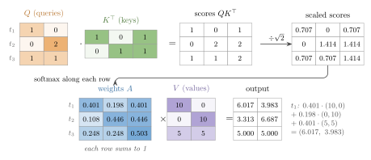
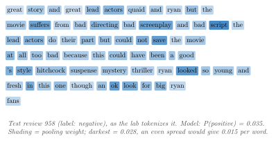

## Learning Objectives

By the end of this lesson you will be able to:

- **Describe** the **query/key/value** roles and the **scaled dot-product attention** formula, and
  **compute** attention by hand for a small example. *(Understand / Apply)*
- **Explain** self-attention and its **learned projections**, the **`sqrt(d_k)`** scale, **padding
  masks**, and **attention pooling**. *(Understand)*
- **Build and train** attention in PyTorch: a content lookup and an IMDB sentiment classifier.
  *(Apply -- in the lab)*
- **Analyze** what attention is good and bad at: its reach compared with a CNN, its quadratic cost, its
  blindness to order, and why its weights are not an explanation. *(Analyze)*

> **Where this sits:** after `L20 — Autoencoders & Representation Learning`, which learned features with
> no labels. Attention is a different idea: a layer that learns, from content, *where to look*. · next:
> `L22 — The Transformer Architecture`, which is built almost entirely out of the attention you build here.
>
> **Hands-on:** [Lab — Attention from Scratch to Movie Reviews](l21_lab_attention.md) ·
> 

## Why This Matters

Here is the start of a real review from the IMDB dataset the lab uses:

> "Great story and great lead actors (Quaid and Ryan) but the movie suffers from bad directing [...]
> Too bad because this could have been a good 80's style Hitchcock suspense/mystery/thriller."

It contains *great* twice and *good* once, and it is a negative review. The verdict depends on how the
words relate to each other (*but*, *suffers from*, *could have been*), and the words that matter are
far apart. A model that reads it needs a way to connect any word to any other word, chosen by what
the words say, not by where they sit.

Every network so far had **fixed wiring**. An MLP mixes a fixed-size vector; a CNN slides a small
window, so one layer only sees neighbors; an autoencoder squeezes a fixed input. None of them can
decide "for *this* input, word 3 should read from word 40." **Attention** can: each position compares
itself with every other position and pulls in information from the ones that match, weighted by how
well they match. It is one formula, and it is the building block of the **Transformer** (L22) and so of
every modern language model.

## From Lookup to Attention

Start with an ordinary dictionary lookup. You give a **query**; the dictionary compares it with every
**key**; the one key that matches exactly returns its **value**. Attention makes this lookup *soft*:

- compare the query with **every** key by a similarity score, the dot product (large when the two
  vectors point the same way);
- turn the scores into **weights** that are positive and sum to 1, with a softmax (L04);
- return the **weighted blend** of all the values.

A hard lookup returns one value or fails; a soft lookup always returns a blend, leaning toward the
values whose keys match best. Every step is differentiable, so the network can *learn* what to put in
the queries, keys, and values by backpropagation. Stack the queries, keys, and values of all positions
as the rows of matrices $Q$, $K$, $V$, and the whole layer is one expression:

$$\text{attention}(Q, K, V) = \operatorname{softmax}\!\left(\frac{Q K^{\top}}{\sqrt{d_k}}\right) V$$

$Q K^{\top}$ holds every query-against-every-key score; dividing by $\sqrt{d_k}$ ($d_k$ is the number of
entries in each key) keeps the scores in a workable range (explained below); the softmax runs **along each row**, so
each query's weights sum to 1; multiplying by $V$ blends the values.

The idea is older than the Transformer. Bahdanau, Cho and Bengio (2014) added attention to a
translation model so that each output word could look back at the input words it corresponds to.
Vaswani et al. (2017) then built a translation model out of attention alone and called the paper
"Attention Is All You Need"; that architecture, the Transformer, is L22.

## A Worked Example by Hand

Three tokens $t_1, t_2, t_3$, with 2-dimensional queries and keys ($d_k = 2$) and 2-dimensional values:

$$
Q = \begin{bmatrix} 1 & 0 \\ 0 & 2 \\ 1 & 1 \end{bmatrix}, \quad
K = \begin{bmatrix} 1 & 0 \\ 0 & 1 \\ 1 & 1 \end{bmatrix}, \quad
V = \begin{bmatrix} 10 & 0 \\ 0 & 10 \\ 5 & 5 \end{bmatrix}
$$

Follow token $t_1$ (the first row) through the four stages:

| Stage | Computation for $t_1$ | Result |
|---|---|---|
| Scores | $(1,0)$ dot each key: $(1,0)$, $(0,1)$, $(1,1)$ | $1,\ 0,\ 1$ |
| Scale | divide by $\sqrt{2} \approx 1.414$ | $0.707,\ 0,\ 0.707$ |
| Softmax | $e^{0.707} = 2.028$, $e^{0} = 1$; total $5.056$ | $0.401,\ 0.198,\ 0.401$ |
| Blend | ${0.401(10,0) + 0.198(0,10) + 0.401(5,5)}$ | $(6.017,\ 3.983)$ |

$t_1$'s query $(1, 0)$ matches keys 1 and 3 equally (score 1 each) and key 2 not at all, so keys 1 and 3
get equal weight and key 2 less, but not zero: a soft lookup never ignores a key entirely. The output is
mostly value 1 and value 3. (The output uses the unrounded weights; blending with the 3-decimal
weights gives $(6.015,\ 3.985)$, which is just as good an answer by hand.) @fig-worked-example shows
all three rows at once; the lab's Step 1 reproduces every number.

{#fig-worked-example width="100%" fig-alt="Top row: an orange 3 by 2 matrix Q times a green 2 by 3 matrix K transpose equals the 3 by 3 score matrix with rows 1 0 1, 0 2 2, 1 1 2; an arrow labelled divide by square root of 2 leads to the scaled scores 0.707 0 0.707, 0 1.414 1.414, 0.707 0.707 1.414. An arrow labelled softmax along each row leads down to the blue weight matrix A with rows 0.401 0.198 0.401, 0.108 0.446 0.446, 0.248 0.248 0.503, shaded by size, noted as each row sums to 1. A times the purple value matrix V with rows 10 0, 0 10, 5 5 equals the output with rows 6.017 3.983, 3.313 6.687, 5.000 5.000; a side note spells out t1's output as 0.401 times (10, 0) plus 0.198 times (0, 10) plus 0.401 times (5, 5)."}

::: {.callout-tip collapse="true"}
## Your turn (by hand): a query that avoids key 2

Use the same $K$ and $V$ with a new query $q = (1, -1)$. Compute the scores, the scaled scores, the
weights and the output, then check the answer below.

**Answer.** Scores: $q \cdot k_1 = 1$, $q \cdot k_2 = -1$, $q \cdot k_3 = 0$. Scaled by $\sqrt{2}$:
$0.707,\ -0.707,\ 0$. Exponentials: $2.028,\ 0.493,\ 1$, total $3.521$, so the weights are
$0.576,\ 0.140,\ 0.284$. Output: $0.576(10,0) + 0.140(0,10) + 0.284(5,5) = (7.180,\ 2.820)$. The query
points away from key 2, so value 2 gets the smallest weight, and the output leans toward value 1.
:::

## Self-Attention and Learned Projections

It is **self**-attention when the queries, keys, and values all come from the **same** sequence: every
token attends to every token, itself included, and the weights form an $L \times L$ matrix for a
sequence of length $L$. Row $i$ says how much token $i$ reads from each token.

The simplest version uses each token's vector $x_i$ directly as its query, key, and value. Then the
score between tokens $i$ and $j$ is $x_i \cdot x_j$, which equals $x_j \cdot x_i$: the score matrix is
**symmetric**, and a token usually matches itself best. In the lab, four tokens built as two
near-duplicate pairs (*cat*/*kitten*, *car*/*truck*) give a clean two-block matrix: each token puts
about 0.5 of its attention on itself and its twin and 0.005 on the others.

Language needs one-sided relations. In "the suitcase was too small, so **it** stayed home", the pronoun
should look *for* a noun; the noun has no reason to look for the pronoun. A real attention layer
therefore gives each token three different vectors, computed by three learned weight matrices:

$$Q = X W_q, \qquad K = X W_k, \qquad V = X W_v$$

With separate $W_q$ and $W_k$, what a token *looks for* (its query) can differ from what it *offers*
(its key), so the scores are no longer symmetric. In the lab, a hand-set $W_q$ that maps "pronoun" to
"looking for a noun" moves *it*'s attention from itself (0.989) to *suitcase* (0.989), while *suitcase*
still attends to itself. In a trained model nobody sets these matrices: they are linear layers learned
by backpropagation.

{#fig-projections width="100%" fig-alt="Left: a gray matrix X of 5 tokens (The, movie, was, not, good) by d features. Three arrows labelled times W q, times W k and times W v lead to an orange Q, a green K and a purple V, each L by d k (V is L by d v). Q and K feed a box 'scores Q K transpose over square root of d k', then a box 'softmax per row', giving a blue L by L weight matrix A, noted as: row i of A is how much token i reads from each token, summing to 1. A and V feed a box A V, which gives the blue output matrix, L by d v."}

## Why Divide by `sqrt(d_k)`

A dot product of two $d_k$-dimensional vectors adds up $d_k$ products. If the entries of the query and
the key are independent with mean 0 and variance 1, the dot product has mean 0 and variance $d_k$, so
its typical size grows like $\sqrt{d_k}$. Dividing by $\sqrt{d_k}$ brings the variance back to 1 at any
dimension.

Why it matters: large scores make the softmax **saturate**. Almost all the weight goes to the single
largest score, and the softmax's output then barely changes when its inputs change, so almost no
gradient flows back through it -- the same vanishing-gradient problem as L17, inside one layer. The lab
measures both effects over random queries and 8 keys:

| $d_k$ | top weight, unscaled | top weight, scaled | gradient size, unscaled | gradient size, scaled |
|---:|---:|---:|---:|---:|
| 4 | 0.529 | 0.344 | 0.340 | 0.360 |
| 16 | 0.748 | 0.359 | 0.252 | 0.363 |
| 64 | 0.875 | 0.361 | 0.151 | 0.366 |
| 256 | 0.938 | 0.362 | 0.082 | 0.365 |

The "gradient size" column measures how much the weights move per unit change of the scores (0 means
nothing can be learned through the softmax). Without the scale, the top weight climbs toward 1 and the
gradient size falls to a quarter of its value; with it, both stay steady.

## Masking the Padding

Real sequences have different lengths, but a batch is one tensor, so short sequences are filled up to a
common length with a `<pad>` token. Without care, every real token would attend to the padding too,
and the output would depend on how much padding the batch happened to need. The fix is a **padding
mask**: before the softmax, set the score of every padded key to $-\infty$. Since $e^{-\infty} = 0$, the
padded keys get weight exactly 0, and the weights of the real keys still sum to 1.

In the lab, 200 short reviews are scored twice, padded to 256 and to 512 positions. With the mask the
two scores are identical; without it, P(positive) moves by 0.11 on average and up to 0.21, and some
labels flip. Forgetting the mask produces no error message, only wrong answers.

## Attention Pooling

A classifier needs one vector per review, not one per word. L18's pooling layers averaged or took the
maximum; **attention pooling** lets the network choose. It adds a single learned query vector $q$ that
belongs to no token, and attends over the sequence with it:

$$c = \operatorname{softmax}\!\left(\frac{q\, H^{\top}}{\sqrt{d}}\right) H$$

where the rows of $H$ are the per-token vectors. The result $c$ is a weighted average of the tokens,
with weights computed from content: positions that match the query count more. Mean pooling is the
special case where every weight is $1/L$. The lab's IMDB classifier uses self-attention followed by
attention pooling.

## Reach: One Hop vs Local Wiring

How many steps does information need to travel between positions 0 and 7?

- A **recurrent** model (one that reads a sequence one position at a time, carrying a running summary;
  not built in this course) needs **7 steps** to carry position 0's information to position 7, and a
  detail can fade at each one.
- A **CNN** with kernel 3 reaches one position further with each layer (L18's receptive field), so it
  needs **7 layers** to connect positions 7 and 0.
- **Attention** connects any two positions in **one layer**, at any distance. Every position is also
  computed at the same time, in parallel, rather than one after another.

{#fig-reach width="100%" fig-alt="Three panels with eight positions x0 to x7. Top: a recurrent chain of arrows from x0 to x7, noted as 7 steps. Middle: a CNN with an input row and three layers; only a cone of nodes is shaded, the readout at position 0 in layer 3, positions 0 and 1 in layer 2, 0 to 2 in layer 1 and x0 to x3 in the input, with the rest gray; the note says 3 layers let position 0 see positions 0 to 3 and position 7 needs 7 layers. Bottom: one attention layer whose node at position 0 is connected directly to all eight inputs."}

The lab tests this claim directly. In a task where the answer sits at a marked position 1 to 31 steps
away from the query, one attention layer scores 1.00 at every distance. A 3-layer CNN scores 1.00 up to
distance 3 and chance (about 1/6) beyond; a 6-layer CNN scores about 1.00 up to distance 6 and chance
beyond. Each model solves exactly what it can reach.

## Order: Equivariance and Invariance

Attention compares tokens by content only; nothing in the formula says *where* a token sits. Two
precise consequences:

- **Self-attention is permutation-equivariant.** Shuffle the input tokens and the outputs are the same
  vectors, shuffled the same way. Each token still gets the same output; it just appears in a new place.
- **A readout that does not depend on order is invariant.** Attention pooling, or reading out at a
  fixed query position while shuffling the other positions, gives the same result after the shuffle
  (up to floating-point rounding, about $10^{-7}$ in the lab).

For the lab's lookup, that is correct: the answer does not depend on slot order (Exercise 1 checks both
properties). For language it is a real weakness. The lab's IMDB attention classifier gives the two
sentences "this movie is not bad, it is good" and "this movie is not good, it is bad" the same
probability of being positive (0.8448), because they contain the same words. Order has to be added to
the tokens from outside, with **positional encoding**, which is part of the Transformer in L22.

## Strengths and Weaknesses in Practice

The lab trains three sentiment classifiers on the 25,000 IMDB training reviews, each with its own
64-dimensional word embedding (the same size for all three):

| Model | Test accuracy | What it sees |
|---|---:|---|
| Bag of embeddings | 0.866 | the average word; no order, no context |
| Self-attention + attention pooling | 0.851 | every word against every word; no order |
| 1-D CNN (window 5) | 0.840 | local word order; nothing beyond 5 words |

The cheapest model wins (the order of the three held on every machine and thread count we tried; the
last digits vary a little). Movie sentiment is carried mostly by *which* words appear (*bad*, *boring*,
*excellent*), so routing between words buys nothing here, and on the authoring CPU the attention model
took about 12 times longer to train than the bag of embeddings. The review at the top of this page
looked as if it needed relations between distant words, and for that one review it does; but across
25,000 reviews, *which* words appear carries most of the signal. Attention earns its cost on tasks
where the answer depends on relations between distant positions, as in the lab's lookup and reach
tasks, and at the scale of large language models.

| Strengths | Weaknesses |
|---|---|
| Any two positions connect in one layer | Cost grows with the square of the length |
| Weights depend on content, per input | Blind to order without positional encoding |
| All positions computed in parallel | Needs a padding mask for batches |
| Handles any length (with a mask) | No notion of "nearby": learned only once positions are added |
| Weights can be inspected | Weights are a hint, not an explanation |

**Cost.** The weight matrix has $L \times L$ entries. Doubling the sequence length quadruples the
memory and, for long sequences, the time. One 8,192-token sequence needs a 256 MB score matrix in
a single attention layer (and L22's multi-head attention keeps one such matrix per head).

{#fig-cost width="100%" fig-alt="Two log-log line charts against sequence length from 256 to 8192. Left: milliseconds per attention call on a CPU, rising from about 0.1 to over 100 along a dashed line labelled grows like L squared. Right: memory of the score matrix in MB rising from 0.25 to 256 for one sequence in one attention layer."}

**Inspecting the weights.** @fig-imdb-attention shows the pooling weights on the review from the start
of this page. The model calls it negative (P(positive) = 0.035), and words such as *script*, *suffers*,
*screenplay* and *save* get more weight than average. But *in* and *looked* are among the top words
too, none of the four copies of *bad* is, and the weights are spread thin. Exercise 3 of the lab tests
whether the most-attended word is the word the prediction depends on most: across 200 reviews, it is
the single most important word in only 9% of them and among the top 3 in about 30%. Attention weights
show where a layer looked, not why the
model decided; treat them as a hint (Jain and Wallace, 2019).

{#fig-imdb-attention width="100%" fig-alt="The words of test review 958, lowercased and without punctuation, laid out in lines of 11 words, each on a blue background whose darkness is its pooling weight. The darkest words include script, looked, ok, save, screenplay and suffers; most words are pale. A note gives the largest weight, the even-spread weight per word, and the model's probability of positive, 0.035."}

## Common Pitfalls

- **Confusing the key with the value.** You **match** on keys (query against key) and **retrieve**
  values. They are different projections of the token for different jobs.
- **Reading the softmax as global.** The softmax runs **per row**: each query's weights sum to 1, not the
  whole matrix.
- **Dropping the `sqrt(d_k)` scale.** In high dimension the softmax saturates and its gradient fades.
- **Forgetting the padding mask.** Nothing crashes; the predictions just change with the amount of
  padding.
- **Saying attention is "order-invariant" without qualification.** Self-attention is equivariant (the
  outputs move with the inputs); only an order-independent readout is invariant. Either way, attention
  alone cannot tell "not good, it is bad" from "not bad, it is good."
- **Reading attention weights as an explanation.** They show where the layer looked, not what the
  decision depended on.
- **Thinking one attention layer is a Transformer.** The Transformer adds multi-head attention,
  positional encoding, and a stack of residual blocks (all L22).

## FAQ / Industry Reality

**"Where is attention actually used?"** -- In **Transformers**, which power essentially all large
language models and much of modern vision and speech. The attention layer you build here is the core of
all of them; L22 assembles it into the full architecture.

**"What is multi-head attention?"** -- Several attention computations in parallel, each with its own
$W_q$, $W_k$, $W_v$, so different heads can attend to different things, then combined. It is L22.

**"Isn't all-to-all expensive?"** -- Yes: the $L \times L$ matrix is the main limit on context length.
**FlashAttention** (Dao et al., 2022) computes *exact* attention in tiles without ever storing the full
matrix, which saves memory and time on GPUs, but the amount of arithmetic still grows with $L^2$.
**Sparse** and **linear** attention change the computation itself and give up some exactness.

**"Did attention replace recurrence?"** -- For most sequence modeling since 2018, yes, mainly because
it trains in parallel and connects distant positions directly. But recurrent ideas are back for very
long sequences: **state-space models** such as Mamba (Gu and Dao, 2023) process a sequence in linear
time, and several recent models mix them with attention layers.

**"Can I trust attention weights as an explanation?"** -- Only as a hint. The lab finds that the
most-attended word is often not the word the prediction depends on most; the research debate is in
Jain and Wallace (2019) and Wiegreffe and Pinter (2019).

## Summary / Cheat-sheet

| Concept | The one-liner |
|---|---|
| Query / Key / Value | what a position seeks / what it offers to match / what it hands over |
| Scaled dot-product attention | `softmax(QK^T/sqrt(d_k))V`: a soft, trainable lookup |
| Attention weights | $L \times L$; row $i$ = how much $i$ reads from each position (sums to 1) |
| Self-attention | Q, K, V from the same sequence; learned `Wq`, `Wk`, `Wv` make relations one-sided |
| `sqrt(d_k)` scaling | keeps the softmax from saturating and its gradient alive |
| Padding mask | `-inf` on padded keys before the softmax: weight exactly 0 |
| Attention pooling | one learned query summarizes a sequence (mean pooling = equal weights) |
| Reach | one layer connects any two positions (a CNN needs depth, a recurrent chain needs steps) |
| Order | self-attention is equivariant; order must be added (positional encoding, L22) |
| Cost | `L^2` time and memory in the sequence length |
| Interpretation | attention weights are a hint, not an explanation |

## Where to Go Deeper

- **Course text:** Géron, *Hands-On Machine Learning*, ch. 16 -- attention and the Transformer
  (query/key/value, scaled dot-product, multi-head) with worked examples.
- **Origin:** Bahdanau, Cho and Bengio (2014), *Neural Machine Translation by Jointly Learning to Align
  and Translate* -- attention as alignment in translation.
- **Foundational:** Vaswani et al. (2017), *Attention Is All You Need* -- attention alone, the
  Transformer.
- **Visual:** Jay Alammar, *The Illustrated Transformer* -- a picture-by-picture walk from scaled
  dot-product attention to the full stack (the L22 material).
- **Interpretation:** Jain and Wallace (2019), *Attention is not Explanation*; Wiegreffe and Pinter
  (2019), *Attention is not not Explanation*.
- **Data:** Maas et al. (2011), *Learning Word Vectors for Sentiment Analysis* -- the IMDB review
  dataset.
