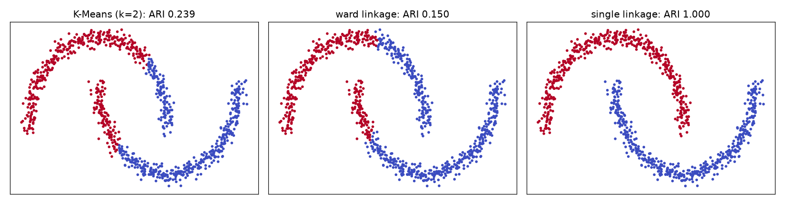

## Learning Objectives

By the end of this lesson you will be able to:

- **Explain** DBSCAN: an `eps`-neighborhood and `min_samples` sort points into **core / border /
  noise**, a cluster is a chain of density-connected core points, there is no `k` to choose, and
  outliers are labelled noise. *(Understand)*
- **Apply** DBSCAN with scikit-learn and **show** it solves L23's crescents -- ARI from K-Means'
  0.239 up to 1.000 on the same moons. *(Apply -- in the lab)*
- **Explain** agglomerative hierarchical clustering: bottom-up merging by a **linkage** rule into a
  **dendrogram** you **cut** at a height to choose the number of clusters. *(Understand)*
- **Compare** K-Means, DBSCAN, HDBSCAN and hierarchical clustering, and choose by the **shape** and
  the **density** of the clusters. *(Analyze)*
- **Diagnose** the dials: DBSCAN's `eps` has a working range with a failure on each side (too small
  fragments the data into noise, too large fuses it into one blob), found with a **k-distance plot**
  on **scaled** features; and the **linkage** choice (single chains along curves, ward and complete
  build compact groups). *(Analyze)*
- **Apply** density clustering to real spatial data: haversine distance in metres, hotspots that
  depend on the parameters, HDBSCAN for clusters of different density, and why hierarchical
  clustering is the wrong tool for hotspots. *(Apply / Analyze -- in the lab)*

> **Where this sits:** after `L23 — K-Means Clustering & Similarity`, this lesson **continues Unit
> VI's clustering trio** by answering the cliffhanger L23 ended on -- two crescents K-Means splits with
> one straight border. · next: `L25 — Gaussian Mixtures & EM` (soft, probabilistic clustering).
> Still **scikit-learn** (plus SciPy for the dendrogram).
>
> **Hands-on:** [Lab — Shapes, Trees, and Crime Hotspots](l24_lab_hierarchical_dbscan.md) ·
> 

## Why This Matters

L23 ended on a freeze-frame: two interleaved crescents, and K-Means cutting a large piece off each
one, because the best two centroids can do is one straight border across both (ARI 0.239). The two
arcs were obvious to your eye but invisible to an algorithm whose only idea of "cluster" is
*distance to a center*. The fix is not a cleverer K-Means -- it is a different **definition of a
cluster**.

This lesson gives you two. **DBSCAN** defines a cluster as a **dense, connected region**, so it
walks around each crescent's curve and -- as a bonus -- labels the stray points as noise.
**Hierarchical** clustering refuses to commit to `k` at all: it merges the two closest groups over
and over and draws the entire **tree** of merges, which you cut wherever you like. On the moons
that beat K-Means, DBSCAN and single-linkage hierarchical clustering both score a perfect ARI of
1.000.

Then the lesson leaves synthetic data behind. Where do robberies concentrate in Puerto Rico? There
is no answer key for that question, and the answer depends on what you call "dense" -- which makes
it the right place to see what density clustering can and cannot tell you.

::: {.callout-tip title="Analogy"}
K-Means is a **mailman** who assigns every house to its nearest post office -- tidy when towns are
round blobs, hopeless when a town is shaped like a banana. DBSCAN is a **rumor**: it spreads from
any crowded house to its near neighbors and on through the crowd, so it traces whatever shape the
crowd actually forms and never reaches the isolated houses out in the fields (the noise).
Hierarchical clustering is a **family tree** of merges: it records who joined whom and at what
distance, and you read off "families" by cutting the tree at whatever height you choose.
:::

## Density-Based Clustering: DBSCAN

**DBSCAN** (Density-Based Spatial Clustering of Applications with Noise) needs no `k`. It takes two
parameters -- `eps` (the neighborhood radius) and `min_samples` (how many points within `eps`, the
point itself included, make a neighborhood "dense") -- and sorts every point into one of three
roles:

- **Core point:** has at least `min_samples` points within distance `eps` (it sits in a dense
  region).
- **Border point:** not core itself, but within `eps` of a core point -- it joins that cluster.
- **Noise point:** neither -- an outlier, given the label **-1**.

A cluster is then a **maximal chain of density-connected core points**, plus the border points
hanging off them. Because clusters grow by *connection* rather than by distance to a center, they
can take **any shape** -- a crescent, a ring, a spiral. And because lonely points never join a
chain, DBSCAN does **anomaly detection for free**: anything labelled -1 is an outlier.

![DBSCAN's three roles. Left: with eps = 0.8 and min_samples = 4, the dashed circles show each point's neighborhood. The core point has 11 points within eps (itself included); the circled border point has only 3, so it is not core, but it lies within eps of a core point and joins that cluster; the circled noise point has only itself. Right: the lab's moons with 15 injected outliers at eps = 0.10 and min_samples = 10 -- 961 core, 39 border points on the thin edges of the crescents, and 15 noise points.](../assets/l24_dbscan_roles.png){#fig-roles width="100%" fig-alt="Two panels. Left: a small cluster of blue core points, two orange border points (one shown with its eps circle) and two black crosses for noise. Dashed circles of radius eps surround one core point (11 points inside), the border point (3 points inside, overlapping the core cluster) and an isolated noise point (only itself inside). Right: two interleaved crescents made of blue core points, with orange border points scattered along their outer edges and black crosses marking 15 noise points spread around the plot. The legend reads core 961, border 39, noise 15."}

In the lab, DBSCAN recovers the two moons at **ARI 1.000** (versus K-Means' 0.239). On those evenly
sampled moons every point is core; @fig-roles shows the roles on the moons with 15 outliers added
and a stricter density rule, where 12 of the 15 outliers are labelled noise.

## Choosing eps

`eps` is DBSCAN's critical dial, and the moons show both ways it fails. Too **small** and few
neighborhoods are dense: at `eps=0.05` the crescents shatter into 7 fragments with 77 noise points,
and at `eps=0.02` almost everything is noise (908 of 1000). Too **large** and the gap between the
crescents is bridged: at `eps=0.50` everything is one cluster. In between is a wide **working
range** -- every value from about 0.08 to 0.30 finds both crescents with an ARI of at least 0.98. The
goal is to land inside the range, not to hit one magic number.

Three tools help:

- **Scale first.** `eps` is one distance for every direction, so it only makes sense when features
  are on comparable scales (the L08/L10 lesson). In the lab, stretching one feature by 20 leaves no
  `eps` that works (best ARI 0.138 among the values tried); after `StandardScaler`, `eps=0.15`
  scores 0.996.
- **The k-distance plot.** For every point, compute the distance to its `min_samples`-th nearest
  neighbor (counting the point itself) and sort those distances. A point is core at a given `eps`
  exactly when that distance is at most `eps`, so the plot shows how much of the data each `eps`
  treats as dense. On textbook data the curve has a sharp "knee" where you set `eps`; on real data
  it is often smooth, and it gives you a sensible range rather than one answer.
- **The right distance.** DBSCAN, HDBSCAN and `AgglomerativeClustering` all take a `metric=`
  argument -- the hand-off L23 promised. For latitude and longitude, Euclidean distance on degrees is
  wrong; `metric="haversine"` measures the great-circle distance on a sphere. It expects
  `(lat, lon)` in **radians** and returns radians, so a radius of 500 m is
  `eps = 500 / 6_371_000` (the Earth's radius in metres).

DBSCAN also has no `predict` method: it is **transductive** -- it clusters the data it is given and
does not build a rule for placing a brand-new point (see the FAQ).

## Hierarchical (Agglomerative) Clustering

**Agglomerative** clustering builds clusters bottom-up. Start with every point as its own cluster,
then repeatedly **merge the two closest clusters**, recording each merge, until a single cluster
remains. The full record is a **dendrogram** -- a tree whose **height** at each join is the cost of
that merge. You then **cut** the tree at a chosen height to read off your clusters (SciPy's
`fcluster`), or ask for a number of branches (`AgglomerativeClustering(n_clusters=k)`). The tall
final merges are the natural cut points, because they join groups that are genuinely far apart.

{#fig-cut width="100%" fig-alt="Two panels. Left: 12 numbered points in three well-separated groups, colored orange, green and red. Right: a dendrogram with leaves 1, 0, 3, 5 in orange / 6, 11, 4, 8 in green / 9, 10, 2, 7 in red, the same colors as the points; low merges under height 2 inside each group, then merges at about 19.6 and 34.2. A dashed red horizontal line at height 10, labelled cut at height 10 gives 3 clusters, crosses three vertical branches."}

The hidden choice is what "closest" means -- the **linkage** rule:

| Linkage | Distance between two clusters | Tends to make |
|---------|------------------------------|---------------|
| **Single** | the **nearest** pair of points | long, chained clusters -- follows curves |
| **Complete** | the **farthest** pair of points | compact, equal-diameter clusters |
| **Average** | the average over all cross-pairs | a middle ground |
| **Ward** | the merge that least increases within-cluster variance | compact, round groups |

The merge **height** is this linkage value. For single, complete and average linkage it is a
distance between the two clusters; for **ward** it is a cost computed from the variance increase, so
read a ward dendrogram's heights as "how far apart" rather than as a distance in the data's units.

Linkage is not a detail -- it changes the answer. On the lab's moons, **single** linkage chains
along each crescent (ARI 1.000), average scores 0.506, complete 0.432, and **ward** 0.150, lower than
K-Means' 0.239. Ward and K-Means share a bias toward compact, round groups, but they do not give the
same answer -- their labels agree with each other at an ARI of only 0.656. Each draws its own border
across the crescents; neither follows them.

{#fig-linkage width="100%" fig-alt="Three scatter plots of the same two interleaved crescents, colored red and blue by the clustering. K-Means, ARI 0.239: the color boundary is a diagonal line, so the upper crescent's right end and the lower crescent's left end take the wrong color. Ward linkage, ARI 0.150: the boundary is in a different place and the lower crescent's left part is red. Single linkage, ARI 1.000: the upper crescent is entirely red and the lower crescent entirely blue."}

A dendrogram needs the distance between every pair of points, so its memory and time grow like
$n^2$. Hierarchical clustering is for modest `n` -- thousands to tens of thousands of points -- but it
gives you the whole merge structure without committing to `k` up front.

## Single Linkage Is DBSCAN With min_samples = 1

The two families are closer than they look. Cut a single-linkage tree at height `eps`: two points
end up in the same cluster exactly when a chain of steps, each shorter than `eps`, connects them.
Now run DBSCAN with that `eps` and `min_samples=1`, so every point is core: clusters are again the
chains of steps shorter than `eps`. The two give **the same grouping** -- in the lab, 693 groups on
the robbery data, ARI 1.0 between them.

So `min_samples` is exactly what DBSCAN adds to single linkage: a **density test** at every link of
the chain. Single linkage alone suffers from the **chaining problem** -- one thin trail of points is
enough to fuse two separate groups, and on the robbery data one chain absorbs 56% of all robberies.
DBSCAN breaks such chains, because a sparse point in the trail is not core and cannot extend a
cluster.

## HDBSCAN: Clusters of Different Density

DBSCAN's weak spot is its single global `eps`: it assumes every cluster has about the same density.
A city and a small town do not. Choose `eps` small enough to separate neighborhoods inside the city
and the town never looks dense; choose it large enough for the town and the city fuses into one
cluster.

**HDBSCAN** (Hierarchical DBSCAN, in scikit-learn since version 1.3) removes `eps`. In effect it
runs DBSCAN at every radius at once, builds the tree of how clusters split as the radius shrinks --
a density version of the dendrogram -- and keeps the clusters that persist over the widest range of
radii. Each cluster is thus found at its *own* density. Its main dial is `min_cluster_size`, the
smallest group you are willing to call a cluster; like DBSCAN, it labels the leftovers -1.

## Clustering at Work: Crime Hotspots

The lab's Part B clusters the locations of 12,178 robberies reported in Puerto Rico from 2015 to
2018 (public incident records, coordinates rounded to about 100 m) with haversine distance.

![Robbery hotspots in Puerto Rico, 2015-2018. Grey dots: every robbery; colored dots: robberies inside a cluster. Top: DBSCAN with eps = 500 m (min_samples = 25) keeps only the densest knots -- 39 clusters, most in metropolitan San Juan, and 50% of robberies are noise. Middle: with eps = 2 km almost every town has a cluster, but the San Juan metro cluster has grown south to Caguas and holds 66% of all robberies. Bottom: HDBSCAN with min_cluster_size = 100 splits the metro area into several hotspots and keeps the town hotspots, each at its own density (in sparse areas a broad region: the Ponce cluster runs along much of the south coast); the largest holds 9%.](../assets/l24_hotspots.png){#fig-hotspots width="100%" fig-alt="Three maps of Puerto Rico drawn only from grey robbery dots. Top, DBSCAN eps 500 m: 39 clusters, 50 percent noise, largest 11 percent; small colored knots concentrated in the northeast metro area, with a few in Caguas, Ponce, Mayaguez and other towns. Middle, DBSCAN eps 2000 m: 27 clusters, 13 percent noise, largest 66 percent; one large pink cluster covers the whole San Juan metro area and extends south toward Caguas, with separate clusters in most coastal towns. Bottom, HDBSCAN min_cluster_size 100: 16 clusters, 50 percent noise, largest 9 percent; several small clusters inside the metro area and clusters in Caguas, Ponce, Mayaguez, Aguadilla, Arecibo, Humacao, Cayey and Guayama."}

Three lessons come out of these maps:

- **The answer depends on the definition.** With no answer key, `eps` and `min_samples` are a
  choice of *what you want to call a hotspot* -- a few blocks or a whole town. The k-distance plot
  gives the range; the maps show the consequences.
- **One density does not fit an island.** DBSCAN cannot give metro-area neighborhoods and
  small-town hotspots in the same run; HDBSCAN can (@fig-hotspots, bottom).
- **Hierarchical clustering is the wrong tool here.** Single linkage chains the metro area into one
  group (56% of robberies). Ward with 12 clusters tiles the island into compact regions and puts
  *every* robbery, even an isolated rural one, into one of them -- 0 noise points. That is a fair
  way to draw districts, but a hotspot is a place *denser than its surroundings*, and ward has no
  notion of "not dense enough". Its $n^2$ cost also rules out a full year of every crime (about
  80,000 records).

The lab's last exercise asks whether vehicle thefts concentrate in the same places. They largely do
-- the metro area, Caguas, Ponce, Arecibo and the west coast -- but they are more concentrated than
robberies, and a few robbery hotspots (Humacao, Guayama) do not appear for vehicles. Clustering
shows *where* to look; it cannot say *why*.

## Choosing the Algorithm

Four clustering methods, four notions of "cluster":

| | **K-Means** (L23) | **DBSCAN** | **HDBSCAN** | **Hierarchical** |
|--|------------------|-----------|-------------|------------------|
| A cluster is | points near a **centroid** | a **dense, connected** region | a dense region that **persists** across densities | a branch of a **merge tree** |
| Shape it finds | round, similar-size blobs | **any** shape | **any** shape | depends on **linkage** |
| Need to pick `k`? | yes | **no** | **no** | no -- cut the tree afterward |
| Outliers | forced into a cluster | **noise (-1)** | **noise (-1)** | forced into a cluster |
| Main dial | `k` | **`eps`**, `min_samples` | `min_cluster_size` | **linkage**, the cut |
| Clusters of different density | assumes similar round blobs | struggles (one `eps`) | **handles** | single linkage chains |
| Large `n`? | yes (fast) | yes with a spatial index; memory grows with `eps` | yes, slower than DBSCAN | no ($n^2$ memory) |

The [decision chart in L23](l23_concept_kmeans_clustering.qmd#fig-which) starts the same way: look
at the shape of your groups first. The rule of Unit VI in one line: **match the algorithm to the shape -- and the density -- of
your data.** Round blobs: centroids. Arbitrary connected shapes and outliers to flag: density
(DBSCAN, or HDBSCAN when densities differ). A full merge tree on modest data: hierarchical.

## Common Pitfalls

- **Expecting one right `eps`.** On the moons a wide range works; on real data the choice of `eps`
  *defines* what counts as a hotspot. Use a k-distance plot for the range, then look at the results.
- **Forgetting to scale before DBSCAN.** A single radius is meaningless when features have different
  numeric ranges -- after stretching one feature, no `eps` worked until the data were standardized.
- **Euclidean distance on latitude and longitude.** Degrees are angles, and a degree of longitude is
  shorter than a degree of latitude away from the equator. Use `metric="haversine"` on radians.
- **Using ward or complete linkage on connected shapes.** They build compact groups and cut crescents
  and rings; for connected structure use **single** linkage (or DBSCAN).
- **Reading a dendrogram's left-to-right leaf order as meaningful.** Only the **merge heights**
  carry information; the horizontal order is a drawing convenience.
- **Treating noise as a failure.** Noise (-1) is an answer: those points are in no dense region. Half
  the robberies being noise says most robberies happen outside any concentration.
- **Expecting DBSCAN to `predict` new points.** It has no `predict`; see the FAQ.

::: {.callout-note title="Deep Dive: why single linkage wraps a crescent (Optional)" collapse="true"}

Single linkage defines the distance between two clusters as the distance between their *nearest*
pair of points. Merging always picks the globally closest such pair, so the algorithm connects each
point to its nearest neighbor first, building long chains that thread along any densely sampled
curve -- a crescent, a ring, a spiral. Cut at height `eps`, that chain-building is *exactly* DBSCAN
with `min_samples=1` (the section above), which is why single linkage and DBSCAN agree on the moons
(both ARI 1.000). The flip side is the **chaining problem**: a single thin bridge of points between
two otherwise separate groups will fuse them, because the nearest cross-pair is tiny. DBSCAN's
`min_samples` blocks such bridges; ward and complete linkage resist them by penalizing spread, which
is also why they cut crescents -- the same property that makes them robust on blobs makes them
wrong on curves. There is no universally best linkage; it depends on the shape you expect.
:::

## FAQ / Industry Reality

**"K-Means, DBSCAN, HDBSCAN, or hierarchical?"** -- Start with the **shape**, then the **density**.
Round, well-separated blobs and you roughly know `k`: K-Means (fast, scales). Arbitrary shapes,
unknown cluster count, or outliers to flag: DBSCAN -- or HDBSCAN when the clusters have different
densities, which in practice is most real data. You want the full merge structure or a specific
linkage, and `n` is modest: hierarchical. There is no universally best clusterer --
scikit-learn's clustering-comparison gallery exists precisely to show each one's failure cases.

**"How do I choose `eps`?"** -- Scale first (or use a metric with real units, like haversine in
metres), then look at a **k-distance plot**: sort every point's distance to its
`min_samples`-th neighbor. If the curve has a clear knee, set `eps` there; if not, it still gives
the range worth trying, and the results at a few values show what each one calls dense. A common
starting point for `min_samples` is twice the number of features; raise it (25 in the lab) when you
only care about substantial concentrations.

**"DBSCAN has no `predict` -- how do I label a new point?"** -- Re-fit if you can. Otherwise the
common workaround uses k-nearest neighbors: train a k-NN classifier on the core points and their
cluster labels, let it label each new point, and call the point noise if it is farther than `eps`
from every core point.

**"Why use HDBSCAN at all if it is better?"** -- It usually is the better default for density
clustering, but it is slower than DBSCAN, and its clusters are harder to explain in one sentence.
When the clusters have similar density, DBSCAN's single radius is simple, fast and easy to defend
("a hotspot is at least 25 robberies within 1 km").

**"Is a crime hotspot map enough to decide where to patrol?"** -- No. A cluster says where reported
incidents concentrate, not why. Reporting rates, how many records could be placed on a map, and
where people live and shop all shape the picture. Clustering tells you where to look closer.

## Summary / Cheat-sheet

| Concept | The one-liner |
|---------|---------------|
| DBSCAN | cluster = a dense, connected region; no `k`; outliers become noise (label -1) |
| core / border / noise | dense / not dense but within `eps` of a core / neither (-1) |
| `eps` | a working range with a failure on each side: too small fragments into noise, too large fuses |
| k-distance plot | sorted distance to the `min_samples`-th neighbor; shows how much data each `eps` calls dense |
| haversine | great-circle distance for lat/lon; radians in, `eps` = metres / 6,371,000 |
| Agglomerative | merge the two closest clusters bottom-up into a dendrogram |
| Dendrogram | the merge tree; **cut** it at a height (the linkage's merge cost) to get clusters |
| Linkage | single = nearest pair (chains, follows curves); complete / average / ward = compact groups |
| single vs ward | moons: single 1.000, ward 0.150 -- ward shares K-Means' bias, not its answer (ARI 0.656) |
| single linkage cut at `eps` | the same grouping as DBSCAN with `min_samples=1`; `min_samples` stops chaining |
| HDBSCAN | DBSCAN at every density at once; finds clusters of different density; dial `min_cluster_size` |
| Choosing | match the algorithm to the **shape** and **density**: blobs -> K-Means, curves -> DBSCAN / single, mixed density -> HDBSCAN, tree -> hierarchical |

## Where to Go Deeper

- **Course text:** Géron, *Hands-On Machine Learning*, ch. 9 -- the DBSCAN and agglomerative-clustering
  sections (core/border/noise, linkage, dendrograms) this lesson follows.
- **Docs:** [scikit-learn's clustering comparison](https://scikit-learn.org/stable/auto_examples/cluster/plot_cluster_comparison.html)
  -- K-Means, DBSCAN, HDBSCAN, ward and others on the same hard shapes side by side; and the
  [HDBSCAN section of the user guide](https://scikit-learn.org/stable/modules/clustering.html#hdbscan).
- **Papers:** Ester, Kriegel, Sander & Xu (1996), *A Density-Based Algorithm for Discovering Clusters*
  -- the original DBSCAN paper; Campello, Moulavi & Sander (2013), *Density-Based Clustering Based on
  Hierarchical Density Estimates* -- HDBSCAN.
