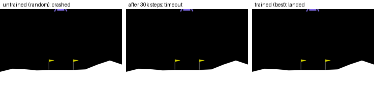

## Learning Objectives

By the end of this lesson you will be able to:

- **Identify** the elements of a reinforcement-learning problem (**agent**, **environment**,
  **state**, **action**, **reward**, and the trial-and-error loop) and contrast RL with supervised and
  unsupervised learning. *(Understand)*
- **Formulate** a task as a **Markov Decision Process**: states, actions, transition probabilities,
  rewards and a discount factor, with a **policy** and a discounted **return**. *(Understand / Apply)*
- **Explain** the value function $V$, the action-value function $Q$ and the **Bellman optimality**
  equation, and **apply** **value iteration** to a gridworld whose model is known. *(Apply)*
- **Apply** tabular **Q-learning** to learn $Q$ from sampled moves without the model, and **explain**
  why it must balance **exploration and exploitation** (epsilon-greedy). *(Apply)*
- **Explain** how a **Deep Q-Network** extends Q-learning to continuous states (a Q-network trained on
  the Bellman target, a **replay buffer**, a **target network**), and **train and evaluate** one on
  LunarLander on unseen episodes. *(Apply)*
- **Analyze** how reward design and training instability shape what an agent learns. *(Analyze)*

> **Where this sits:** this lesson **closes CDAT 4011** (Unit VIII). Units I-IV learned from labelled
> data, Unit V built deep networks, Units VI-VII found structure in unlabelled data;
> `L01 — What Is Machine Learning?` named a third paradigm, and this lesson makes it real. It climbs
> one ladder, three steps high, each step knowing less about the world: **plan** with a known model,
> **learn** from samples with a table, then **learn** with a neural network when no table can hold the
> states. The last step reuses everything from Unit V: a PyTorch network, a regression loss, the
> training loop.
>
> **Hands-on:** [Lab — From Value Iteration to a Deep Q-Network](l28_lab_reinforcement_learning.md) ·
> [](https://colab.research.google.com/github///blob//u08_reinforcement_learning/l28_lab_reinforcement_learning.ipynb)

## Why This Matters

No one handed you a labelled dataset of correct muscle movements when you learned to ride a bike. You
tried, wobbled, fell and adjusted; the falls and the metres you stayed upright were the only feedback
you got. That is **reinforcement learning**: an **agent** acts in an **environment**, receives a
number called the **reward**, and learns behaviour that earns as much reward as possible over time,
by trial and error rather than from answers. There is no fixed training set and no target label, just
consequences. The same idea, scaled up, learned to play Atari games from raw pixels and to beat world
champions at Go. In this lesson's lab it learns to land a spacecraft.

::: {.callout-tip title="Analogy"}
Training a dog: you cannot explain "sit" in words, so you reward the behaviour you want and withhold
the treat otherwise. The dog (the **agent**) tries actions, feels the consequences (**reward**), and
slowly shifts its **policy** toward whatever earns treats. It never sees a labelled list of correct
moves; it learns the mapping from situations to actions purely from reward. Reinforcement learning is
that loop, written as math.
:::

## The Third Paradigm

The earlier units learned from a fixed dataset: **supervised learning** maps inputs to given labels,
**unsupervised learning** finds structure in unlabelled data. **Reinforcement learning** has no
dataset at all. An **agent** interacts with an **environment** in a loop: it observes a **state**,
picks an **action**, and the environment returns a **reward** and a new state. The agent's goal is to
maximize its **cumulative** reward, so an action must be judged by its long-term consequences, not
only by what it pays right away.

```{mermaid}
flowchart LR
  A["Agent<br/>(policy pi)"] -- "action a_t" --> E["Environment"]
  E -- "new state s_t+1<br/>reward" --> A
```

The hard part is that rewards can be **delayed**: a move now may only pay off, or backfire, many
steps later, so the agent must work out which early actions deserve credit for a later reward. The
agent also produces its own data: what it sees depends on what it does.

## The Markov Decision Process

The standard formalism is the **Markov Decision Process** (MDP), the tuple

$$
(\mathcal{S},\ \mathcal{A},\ P,\ R,\ \gamma)
$$

with **states** $\mathcal{S}$, **actions** $\mathcal{A}$, **transition dynamics** $P(s' \mid s, a)$
(the probability of landing in $s'$ after action $a$ in $s$), a **reward** $R(s)$ for being in state
$s$, and a **discount factor** $\gamma \in [0, 1]$. The *Markov* property is the key modelling
assumption: the next state depends only on the current state and action, not on the history. A
**policy** $\pi(s)$ chooses the action in each state, and the agent maximizes the expected discounted
**return** from the states it visits, $s_0, s_1, s_2, \dots$:

$$
G = R(s_0) + \gamma R(s_1) + \gamma^2 R(s_2) + \cdots = \sum_{k=0}^{\infty} \gamma^k R(s_k).
$$

The discount trades immediate against future reward: near 0 the agent is short-sighted, near 1 it
plans far ahead.

{#fig-gridworld fig-alt="A 3 by 4 grid with a hatched wall at row 1 column 1, a +1 goal at the top right, a -1 pit below it, a start square at the bottom left, and -0.04 in every other square; beside it, a square labelled robot chooses N with an arrow up marked 0.8 intended and arrows left and right marked 0.1."}

In the gridworld of @fig-gridworld, $\mathcal{S}$ is the 11 squares, $\mathcal{A}$ is
{N, S, E, W}, $P$ is the noisy motor (0.8 intended, 0.1 to each side), $R$ is +1 and -1 at the
terminals and -0.04 elsewhere, and $\gamma = 1$. A discount of 1 is safe here because every episode
ends at a terminal, so the return is a finite sum.

## Part A — The Model Is Known: Bellman and Value Iteration

How good is a state? The **value function** $V^{\pi}(s)$ is the expected return from $s$ when
following policy $\pi$; the **action-value function** $Q^{\pi}(s, a)$ is the expected return after
taking action $a$ in $s$ and following $\pi$ thereafter. The *best* achievable values satisfy the
**Bellman optimality** equation: a state's optimal value is its reward plus the discounted value of the
best action's expected outcome,

$$
V^{*}(s) = R(s) + \gamma \max_{a} \sum_{s'} P(s' \mid s, a)\, V^{*}(s').
$$

The same pieces define the optimal action-value, and the two functions are tied together:

$$
Q^{*}(s, a) = R(s) + \gamma \sum_{s'} P(s' \mid s, a)\, V^{*}(s'),
\qquad
V^{*}(s) = \max_{a} Q^{*}(s, a).
$$

The value of a state is the value of its best action, and the optimal policy takes that action:
$\pi^{*}(s) = \arg\max_a Q^{*}(s, a)$.

The Bellman equation is a fixed-point equation, and **value iteration** solves it the obvious way:
start from any values and apply the update to every state, again and again, until nothing changes. On
the gridworld it converges in 37 sweeps to values that match Russell & Norvig's published example to
three decimals, and the greedy policy steers around the pit: the square beside it points *away* from
the -1 (North), accepting a small chance of slipping into it rather than walking toward it. The policy
settles early (after 12 sweeps here); the remaining sweeps
only refine the numbers.

Value iteration has one hard requirement: it uses $P$ and $R$ in every update. It **plans** with a
known model. Most real agents are not given one.

## Part B — The Model Is Unknown: Q-Learning

An agent without the model can still **try** a move and see where it lands. **Q-learning** turns each
such sample into a small Bellman update. After a move from $s$ with action $a$ that lands in $s'$, it
computes the **TD target** (temporal-difference target), the Bellman right-hand side estimated from one
outcome instead of the full distribution, and moves its estimate a step $\alpha$ toward it:

$$
Q(s, a) \leftarrow Q(s, a) + \alpha \Big[\, \underbrace{R(s) + \gamma \max_{a'} Q(s', a')}_{\text{TD target}} - Q(s, a) \Big].
$$

The bracket is the **TD error**. No $P$ appears: the noise is averaged over many visits instead of
being summed over in one step. In the lab, 20,000 episodes of trial and error recover value
iteration's policy in all 9 non-terminal squares, with the start square's action-values within 0.002
of the exact ones.

There is a catch that value iteration never faced. To *find* good actions the agent must try actions
it is unsure about (**exploration**); to *collect* reward it should take the action it currently
believes is best (**exploitation**). Order your favourite dish every time and you never discover a
better one; always try something new and you rarely enjoy the one you know. The standard rule is
**epsilon-greedy**: with probability $\varepsilon$ take a random action, otherwise the greedy one, with
$\varepsilon$ decaying from 1 toward a small floor as training goes on. Without exploration the
learner locks onto the first route that works and never tests the alternatives, which the lab's
Exercise 2 shows.

## Part C — Too Many States: Deep Q-Networks

The gridworld's $Q$ fits in a table of 36 numbers (9 non-terminal squares, 4 actions each). A lunar
lander's state is **8 numbers**, six of them continuous (position, velocity, angle, angular velocity)
plus two leg-contact flags, so no table can list every state.
A **Deep Q-Network** (DQN) replaces the table with a neural network $Q(s, \cdot\,; \theta)$ that takes
a state and outputs one value per action. Training it is a **regression**: the prediction is
$Q(s, a; \theta)$ for the action taken, and the label is the TD target, here with the reward $r$ that
came with the move

$$
y = r + \gamma \max_{a'} Q_{\text{target}}(s', a'),
$$

with the future term dropped when the move ended the episode. The loss is a squared-error-style loss
(the lab uses the Huber loss), minimized with Adam in the usual Unit V loop. Two additions make this
work in practice:

- **Experience replay.** Consecutive moves are nearly identical, so training on them in order would
  feed the network long runs of correlated examples. The agent stores its recent moves in a **replay
  buffer** and trains on random batches drawn from it, which also reuses every move many times.
- **A target network.** The label $y$ depends on the network itself, so every update would move the
  target it is chasing. A frozen copy, $Q_{\text{target}}$, computes the labels and is refreshed only
  every few hundred steps.

```{mermaid}
flowchart TD
  Q["Q-network"] -- "epsilon-greedy action" --> E["Environment"]
  E -- "move (s, a, r, s')" --> B["Replay buffer<br/>(last 50,000 moves)"]
  B -- "random batch" --> L["Regression step:<br/>Q(s,a) toward the TD target"]
  T["Target network<br/>(frozen copy)"] -- "TD target" --> L
  L -- "gradient step" --> Q
  Q -. "copy every 250 steps" .-> T
```

Even so, DQN training is **unstable**: the agent's score can climb past the goal and collapse again a
few thousand steps later. The lab therefore tests the greedy agent every 10,000 steps, keeps the best
weights, and stops only when **two tests in a row** clear the goal; then it measures the result on
episodes that took no part in those decisions. On LunarLander (solved at an average return of 200) the
lab's trained network averages 265.7 on 20 unseen episodes and lands in 19 of them; a random agent
averages -214.9 and crashes in all 20. The same code with a different number of CPU threads follows a
different path, and one such run passed two tests in a row yet scored only 161 on the unseen
episodes: the safeguards make success likely, not certain, which is why the unseen score is the one
to report.

{#fig-lander-stages fig-alt="Animated three-panel image. Left: the untrained lander tumbles and crashes beside the landing pad. Middle: the partly trained lander hovers just above the pad without touching down until the time limit. Right: the trained lander descends between the yellow flags and lands upright."}

@fig-lander-stages shows the path the learning curve hides. The untrained agent crashes. Partway
through training the agent **hovers**: it has learned that crashing costs -100 and that hovering is
safe, but not yet how to land, so it hangs above the pad until the episode's time limit. Only later
does it learn to touch down. Nothing in the reward said "hover"; it was the safest behaviour the agent
had found so far.

## The Map

```{mermaid}
flowchart TD
  K("Does the agent<br/>know P and R?")
  K -- "yes: plan" --> MB["Model-based:<br/>value iteration (Part A)"]
  K -- "no: learn from experience" --> W("What does it learn?")
  W -- "values Q(s,a)" --> T("Can a table hold the states?")
  T -- "yes" --> QL["Tabular Q-learning (Part B)"]
  T -- "no" --> DQN["Deep Q-Network (Part C)"]
  W -- "the policy directly" --> PG["Policy gradients<br/>(beyond this course)"]
```

The first split is whether the agent has a model: with $P$ and $R$ in hand, solving the MDP is a
**planning** problem (**model-based**); without them it must learn from experience (**model-free**).
Model-free methods then split by *what* they learn. **Value-based** methods, everything in this lesson,
learn $Q$ and act greedily on it. **Policy-based** methods, such as **policy gradients**, adjust a
parameterized policy directly in the direction that raises the expected return; they handle continuous
actions (a steering angle, a throttle) that a $\max_a$ over a list cannot.

::: {.callout-note title="Deep Dive: why a replay buffer and a target network? (Optional)" collapse="true"}

Supervised learning quietly relies on two things: the training examples are **independent**, and the
**labels do not change** while the model trains. Naive deep Q-learning breaks both.

**Correlated examples.** An agent's moves come in long, smooth sequences: the lander's state at step
500 is almost the same as at step 499. Training on moves in the order they happen gives the network
hundreds of near-copies in a row, so each update pushes it toward whatever the agent is doing *right
now*, and it forgets the rest. The replay buffer stores the last 50,000 moves and samples batches at
random, so each batch mixes moves from many episodes and stages, closer to the independent examples
gradient descent expects. It also lets every expensive interaction with the environment be reused many
times.

**A moving target.** The label $y = r + \gamma \max_{a'} Q(s', a')$ is computed with the network being
trained. Every gradient step that changes $Q(s, a)$ also changes $Q(s', a')$ for similar states, so the
label shifts in the same direction as the prediction, which can feed on itself and diverge. Freezing a
copy for the labels, refreshed every few hundred steps, turns each stretch between refreshes into an
ordinary regression with fixed labels.

Neither trick removes instability entirely, which is why the lab still keeps the best weights and asks
for two good tests in a row. Later refinements build on the same design: Double DQN separates
choosing the best next action from evaluating it, which targets the overestimation that the $\max$
in the label introduces, and Dueling networks split $Q$ into a value for the state plus an advantage
for each action.
:::

## Common Pitfalls

- **Designing a reward that does not mean what you think.** The agent optimizes the reward you
  *wrote*, not the goal you *intended*. In the gridworld a living reward of -2.0 makes the robot dive
  into the pit to end the pain (lab Exercise 1). The lander's hover shows the reward's shape at work
  in a different way: the -100 crash penalty makes "never crash" the first thing worth learning, so
  training sits on a safe but poor plateau for tens of thousands of steps. Reward design is the real
  engineering problem in RL.
- **Calling a run "solved" from the test that stopped it.** The stopping rule picked its moment by
  looking at a few test episodes, so their score is optimistic, exactly like a validation score after
  model selection. Report the score on episodes that played no part in the decision.
- **Turning exploration off.** A purely greedy learner sticks with the first route that works and never
  learns whether another is better (lab Exercise 2).
- **Confusing the reward with the return.** The agent maximizes the discounted return, not the next
  reward; a good move can cost a little now for a large gain later.
- **Assuming value iteration always applies.** It needs a **known** model. When the agent must learn
  from experience, use a model-free method such as Q-learning.
- **Mixing up $V$ and $Q$.** $V(s)$ scores a *state*; $Q(s, a)$ scores an *action in a state*. An agent
  without a model acts on $Q$, because choosing an action from $V$ requires a look ahead through $P$.

## FAQ / Industry Reality

**"How is RL different from supervised learning?"** — No labels and no fixed dataset. The agent
generates its own data by acting, and its only feedback is a reward that may arrive many steps after
the action that earned it. Inside a DQN there *is* a supervised regression, but its labels are built
from the network's own current estimates, not answers from outside.

**"What is the difference between $V$ and $Q$?"** — $V(s)$ is the value of being in a state; $Q(s, a)$
is the value of taking a specific action there. $V^{*}(s) = \max_a Q^{*}(s, a)$, and $Q$ is what a
model-free agent acts on.

**"Is this deep reinforcement learning?"** — Part C is: a DQN is deep RL in its simplest form, the
approach that learned Atari games from pixels in 2015 (with a convolutional network in place of the
lab's small multilayer perceptron). Modern systems add policy-based methods, better exploration and
far more compute.

**"Do I need a GPU?"** — Not for this lab. The network is small and the agent acts on one state at a
time, so most of the time goes to the simulator and to moving single states around. In trial runs a
Colab T4 was only about 1.4 times faster per step than a Colab CPU.

**"Why discount future rewards?"** — It keeps the return finite on long or endless tasks and encodes a
preference for sooner reward; $\gamma$ is the knob between short-sighted and far-sighted behaviour.

## Summary / Cheat-sheet

| Concept | The one-liner |
|---------|---------------|
| Reinforcement learning | an agent learns from **reward** by trial and error; no labels, no fixed dataset |
| MDP | $(\mathcal{S}, \mathcal{A}, P, R, \gamma)$: states, actions, transitions, reward, discount |
| Policy $\pi$ / return $G$ | what the agent does / the discounted sum of rewards it collects |
| $V$ / $Q$ | expected return from a **state** / from an **action in a state**; ${V^{*}=\max_a Q^{*}}$ |
| Bellman optimality | $V^{*}(s) = R(s) + \gamma \max_a \sum_{s'} P(s'\mid s,a)\, V^{*}(s')$ |
| Value iteration | apply the Bellman update until convergence; needs the model (**model-based**) |
| Q-learning | move $Q(s,a)$ toward the TD target from one sampled move; no model (**model-free**) |
| Epsilon-greedy | random action with probability $\varepsilon$, else greedy; balances exploration and exploitation |
| Deep Q-Network | a network replaces the Q-table; the TD target is a regression label |
| Replay buffer / target network | random batches of stored moves / a frozen copy that holds the label still |
| Instability | keep the best weights, stop after two good tests, report unseen episodes |

## Where to Go Deeper

- **The standard reference:** Sutton & Barto, *Reinforcement Learning: An Introduction* (2nd ed., free
  online): MDPs, the Bellman equations, value iteration, Q-learning and TD learning at book length.
- **Course text:** Géron, *Hands-On Machine Learning*, ch. 18: the agent-environment loop, policy
  gradients, Q-learning and deep Q-networks, with code.
- **The DQN paper:** Mnih et al., "Human-level control through deep reinforcement learning", *Nature*
  518 (2015): experience replay and the target network, applied to 49 Atari games.
- **The environments:** the Gymnasium documentation (Farama Foundation) describes LunarLander and many
  other environments to try the lab's agent on.
